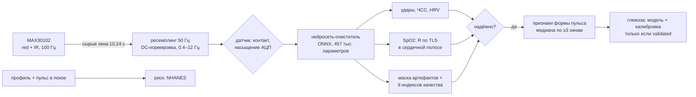

# SuGuard ML

Машинное обучение для браслета SuGuard (ESP32 + MAX30102: красный 660 нм, ИК 880 нм, 18-битный АЦП):

1. **очистка сигнала от движения** — нейросеть (1D U-Net) на двух каналах красный/ИК;
2. **ЧСС, SpO2, HRV, качество сигнала** — с «стоп-краном»: ненадёжное окно не выдаёт чисел;
3. **оценка глюкозы** — конвейер обучения/проверки и персональная калибровка по глюкометру
   (модель не обучена: нет парных данных — см. «Глюкоза»);
4. **риск диабета** — откалиброванная модель на реальных данных NHANES (лабораторный HbA1c).

> ⚠️ Исследовательский прототип, не медицинское изделие. Глюкоза по PPG **не подтверждена**.

## Результаты (на данных, не участвовавших в обучении)

### Очистка от движения + ЧСС/SpO2 — `models/denoiser.onnx`

Полный конвейер со всеми проверками надёжности, 600 новых окон симулятора MAX30102
(движение разной силы, перфузия 0.08–5 %; `models/metrics/denoiser_eval.json → pipeline_with_gates`):

| | Без нейросети (классика) | С нейросетью |
|---|---|---|
| Окон, где выдана ЧСС | 37 % | **57 %** |
| ЧСС: MAE / 95-й перцентиль | 3.6 / 13.1 уд/мин | **0.52 / 1.4 уд/мин** |
| Ошибок ЧСС > 10 уд/мин | 13 | **0.52 / 1.4 уд/мин10** |
| SpO2: MAE / 95-й перцентиль | 0.70 / 2.2 % | **0.16 / 0.5 %** |
| Ошибок SpO2 > 4 % | 7 | **0** |

Реальные PPG-записи (heartpy: реальная форма пульса и вариабельность ритма) + смоделированное движение
(`real_ppg_simulated_motion`), ошибка ЧСС без гейтинга:

| Сценарий | Без нейросети | С нейросетью |
|---|---|---|
| Покой | 1.28 уд/мин | **0.37 уд/мин** |
| Ходьба (движение на частоте, близкой к пульсу) | 21.9 уд/мин | **3.4 уд/мин** |
| Жесты, смена давления | 5.7 уд/мин | **1.5 уд/мин** |

Ограничение: движение — смоделированное. Проверка на **реальном** движении (PPG-DaLiA, эталон по ЭКГ)
и на записях самого браслета — в Colab и при сборе данных.

### Риск диабета — `models/risk_model.json`

NHANES 2017–2018, 4318 взрослых без диагноза диабета, out-of-fold (5×5 кросс-валидация):

| Цель | AUC [95 % ДИ] | Калибровка (наклон) |
|---|---|---|
| HbA1c ≥ 5.7 % (преддиабет или диабет), 34 % выборки | **0.770** [0.756–0.783] | 1.00 |
| HbA1c ≥ 6.5 % (недиагностированный диабет), 3.6 % | **0.789** [0.749–0.815] | 0.97 |

Входы: возраст, пол, ИМТ, пульс в покое (браслет), физическая активность, происхождение
(азиатское / европейское / другое). Без происхождения модель занижала риск у азиатов (0.28 vs 0.38)
и завышала у европейцев (0.35 vs 0.28); теперь обе группы, важные для Казахстана, откалиброваны
(0.382 vs 0.383 и 0.277 vs 0.277). Для чернокожих и мексиканцев остаётся систематика
(`models/metrics/risk_cv.json → subgroup_calibration`). Это уровень известных скрининговых
опросников (ADA, FINDRISC) и **не диагноз**; для Казахстана калибровку нужно подтвердить на местных
данных с HbA1c.

## Глюкоза: что реально, а что нет

* **«Пульс + сатурация → точный сахар» не работает.** ЧСС и SpO2 почти не содержат информации о
  глюкозе. Шанс есть только у формы пульсовой волны + контекста (время, еда) + персональной калибровки,
  и его нужно доказать на данных.
* При проверке «по людям» опубликованные PPG-модели глюкозы падают до R² ≈ 0; высокие цифры —
  следствие утечки (один человек и в обучении, и в тесте) ([arXiv 2608.01820](https://arxiv.org/abs/2608.01820)).
* Даже константа даёт «хорошие» цифры. Реальные CGM (`scripts/benchmark_calibration.py`):

  | Когорта (реальные CGM) | «Среднее по популяции» | Последний укол глюкометра | Калибровка Калмана |
  |---|---|---|---|
  | 19 чел., преддиабет/СД (Hall 2018) | MARD **16.9 %**, Кларк A 68 % | 17.8–20.4 % | **15.1–16.1 %** |
  | 5 чел., СД2 (Broll 2021) | MARD 35 % | 21.5–27.7 % | **21.6 %** |

  То есть «точность 83 %» (100 − MARD) у людей без выраженного диабета даёт константа.
* `scripts/train_glucose.py` выдаёт три протокола (случайное разбиение — только чтобы показать
  завышение; новые люди; калибровка уколами по расписанию на первые дни и проверка на следующих днях),
  базовые модели без PPG (уровень по уколам, последний укол, личный суточный профиль), контроли
  («только контекст» и «PPG перемешан внутри человека»), bootstrap-ДИ по людям и запертую
  отложенную группу людей. Модель получает `validated` **только** если: данные с браслета SuGuard,
  ≥ 20 человек, выигрыш ≥ 10 % у лучшей базовой модели (нижняя граница ДИ > 0), PPG лучше обоих
  контролей, MARD ≤ 15 % и Кларк A+B ≥ 99 % после калибровки — и то же на отложенных людях.
* Без валидированной модели API **не выдаёт** число глюкозы: статус `unavailable`, а после уколов —
  `calibration_only` с явной подписью «среднее ваших уколов, не измерение браслета».
* Положительный и отрицательный контроли (`tests/test_models.py`) проверяют, что эта логика
  находит настоящий сигнал и не принимает за него время суток или шум.

Что нужно, чтобы глюкоза стала реальной: [docs/DATA_COLLECTION.md](docs/DATA_COLLECTION.md).

## Архитектура



* Red и IR нормируются **одним** коэффициентом: сеть сохраняет их отношение (основа SpO2) и учится
  отличать движение (оно меняет каналы в другой пропорции, чем пульс артерий).
* Перфузия проверяется **на входе** сети: сеть, обученная выдавать чистый пульс, может «нарисовать»
  его из шума, поэтому её выход сам себя не подтверждает.
* Гейты разделены: ЧСС требует чистого ритма; SpO2 и признаки для глюкозы — ещё и согласия каналов.

## Быстрый старт

```bash
cd ml
python -m venv .venv && . .venv/bin/activate
pip install -r requirements.txt
python -m pytest -q
uvicorn api.app:app --port 8000
```

```python
from suguard_ml.pipeline import SuGuardPipeline
pipe = SuGuardPipeline.load()                       # models/denoiser.onnx
res = pipe.analyze(red_counts, ir_counts, fs=100)   # сырые отсчёты MAX30102
res["reliable"], res["heart_rate"]["bpm"], res["spo2"]["percent"], res["quality"]["sqi"]
```

### API

| Метод | Назначение |
|---|---|
| `GET /health` | загруженные модели |
| `POST /v1/analyze` | `{fs, red[], ir[], timestamp, temperature_c}` → надёжность, ЧСС, SpO2, HRV, признаки |
| `POST /v1/glucose/estimate` | признаки ≥ 3 надёжных окон + состояние калибровки → глюкоза **со статусом** |
| `POST /v1/glucose/calibrate` | укол глюкометра → новое состояние калибровки (хранит клиент) |
| `POST /v1/risk` | возраст, рост/вес, пол, происхождение, пульс в покое, активность → вероятности, категория, факторы |

```bash
curl -s localhost:8000/v1/risk -H 'content-type: application/json' \
  -d '{"age": 52, "height_cm": 172, "weight_kg": 90, "ancestry": "asian", "resting_hr_bpm": 78, "physically_active": false}'
```

Docker без PyTorch: `docker build -f api/Dockerfile -t suguard-ml . && docker run -p 8000:8000 suguard-ml`.
Лимиты: тело ≤ 2 МБ, ≤ 60 000 отсчётов на канал, время — unix-секунды.

## Рекомендации для приложения и сайта

Модели честны только если честно показаны. По итогам ревью (включая советника):

1. **Убрать эвристический «риск диабета %»** из `health_service.dart` (85 из 100 баллов в нём — от
   неподтверждённого потока «глюкозы») и заменить на `/v1/risk`: «вероятность повышенного HbA1c,
   скрининговая оценка», категория, факторы, призыв «сдайте HbA1c или глюкозу натощак».
2. **Убрать автоматическое письмо экстренному контакту при риске ≥ 70.** Хронический риск — не
   экстренная ситуация; письмо третьему лицу должно быть явным, подтверждённым пользователем
   действием. Экстренные оповещения — только по проверенным острым событиям (их пока нет).
3. **Не показывать мг/дл с браслета**, пока модель не `validated`. В исследовательском режиме —
   диапазон и интервал, постоянная пометка «экспериментально», без оповещений о гипо/гипергликемии.
4. **SpO2 подписать «не откалибровано»** до калибровки по медицинскому пульсоксиметру.
5. **Заявление «94.2 % точности» на сайте** нужно подтвердить исследованием (сколько людей, какое
   разбиение, какой эталон) или убрать; добавить «не медицинское изделие».
6. Добавить в анкету пол и происхождение (улучшают точность риска), хранить согласие на обработку
   данных о здоровье.

## Обучение

```bash
python scripts/train_risk.py --out models                         # NHANES, ~2 мин
python scripts/benchmark_calibration.py --out models/metrics      # реальные CGM
python scripts/make_denoiser_dataset.py --out data/denoiser       # 150 тыс. окон, ~15 мин на 4 CPU
python scripts/train_denoiser.py --data data/denoiser --steps 12000 --out models   # ~40 мин CPU / минуты на GPU
python scripts/eval_denoiser.py --data data/denoiser --out models/metrics
python scripts/train_glucose.py --table data/paired.parquet --out models --tz-offset-h 5   # парные данные
```

Colab с GPU и открытыми датасетами (BIG IDEAs, PPG-DaLiA, веса NHANES):
[notebooks/SuGuard_ML_Colab.ipynb](notebooks/SuGuard_ML_Colab.ipynb).

## Прошивка

`firmware/suguard_raw_stream` — эталонный скетч ESP32 + MAX30102 (не проверен на железе): 100 Гц,
оба светодиода, окна 10.24 с, отправка в API (`MODE_API`) или в Firebase для сбора обучающих данных
(`MODE_COLLECT`, экспорт — `scripts/export_firebase_raw.py`). Сырые отсчёты обязательны: из готовых
чисел pulse/spo2, которые сейчас пишет устройство, движение убрать уже нельзя.

## Структура

```
suguard_ml/
  signal/    filters, beats (Elgendi), spo2 (TLS), quality (SQI), features (морфология, SDPPG, гармоники)
  synth/     симулятор MAX30102 + артефакты движения (только для очистителя)
  models/    denoiser_net (PyTorch), denoiser (ONNX), glucose, risk
  data/      nhanes, cgm (iglu), realppg (heartpy), bigideas, paired (свои данные)
  eval/      метрики глюкозы (Кларк, ISO 15197, MARD), оценка ЧСС/SpO2
  pipeline.py
api/  scripts/  models/  firmware/  notebooks/  docs/ (DATA_COLLECTION.md, MODEL_CARD.md)  tests/
```

## Источники данных

* NHANES 2017–2018 (CDC, общественное достояние) через пакет [`nhanes`](https://pypi.org/project/nhanes/).
* Реальные CGM: `iglu-py` (Broll et al. 2021; Hall et al., PLoS Biol 2018) — только для оценки.
* Реальные PPG: `heartpy` (van Gent et al. 2019) — только для оценки.
* В Colab: [BIG IDEAs Lab Glycemic Variability](https://physionet.org/content/big-ideas-glycemic-wearable/) (PhysioNet, ODC-By),
  [PPG-DaLiA](https://archive.ics.uci.edu/dataset/495/ppg+dalia) (UCI).
