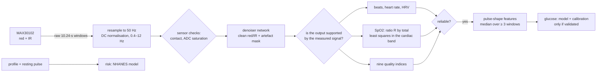

# SuGuard ML

Machine learning for the SuGuard bracelet (ESP32-C3 + MAX30102: red 660 nm, infrared 880 nm,
18-bit ADC).

| Part | State |
|---|---|
| **Motion-artefact removal** — a neural network that cleans red/IR PPG windows. Two versions: a server model (`models/denoiser.onnx`) and a small integer model that runs on the bracelet itself (`models/denoiser_edge_int.npz`, compiled into the [firmware](../firmware/README.md)) | trained; evaluated on simulated sensor data and on real PPG recordings with simulated motion. Not yet tried on a real wrist |
| **Heart rate, SpO2, HRV, signal quality** with reliability gates: a window that fails a check yields no number | implemented in Python and, decision for decision identical, in C++ for the firmware |
| **Diabetes-risk screening** | trained and cross-validated on real data (NHANES 2017–2018, laboratory HbA1c) |
| **Glucose** | training/validation pipeline and personal calibration from fingersticks are ready. **There is no model**: no paired PPG/glucose data from this bracelet exists |

> Research prototype, not a medical device. Glucose from PPG is **not confirmed**: neither the API
> nor the firmware outputs a glucose value.

## Results

All numbers are measured on data the models did not see during training; each table names the
file it comes from.

### Motion artefacts, heart rate, SpO2

Three ways of processing a 10.24-s window are compared:

* **classical** — filters, beat detection and quality checks, no network (firmware: `use_nn 0`);
* **bracelet** — the integer network that runs on the ESP32-C3 (94,667 weights, 45 kB of working memory);
* **server** — the larger network (457,267 parameters, ONNX).

The simulated test data comes from a simulator of the MAX30102 whose pulse shapes span four
families, from a sharp fingertip-like pulse to an almost sinusoidal wrist pulse and to pulses whose
2nd harmonic is stronger than the fundamental (a deep notch and a large diastolic wave), because
real recordings span that whole range ([model card](docs/MODEL_CARD.md#1-motion-artefact-denoiser)).
The networks shipped now (v5) were trained over the pipeline's whole heart-rate band (35–210 bpm)
and with rhythmic motion from steady to wandering in amplitude; where a table shows "v4", that is
the version shipped before, scored with the same code and data (`models/metrics/previous/`).

**Whole pipeline with every reliability check**, 600 simulated windows (motion of every strength,
perfusion 0.08–5 %; `models/metrics/denoiser_eval.json` and `denoiser_edge_eval.json` →
`pipeline_with_gates`):

|  | Classical | Bracelet | Server |
|---|---|---|---|
| Windows that get a heart rate | 36 % | 51 % | 54 % |
| … of the windows without motion | 94 % | 94 % | 94 % |
| Heart rate: mean / 95th-percentile error | 2.06 / 2.1 bpm | 0.39 / 1.4 bpm | 0.33 / 1.1 bpm |
| Heart-rate errors above 10 bpm | 7 | 0 | 0 |
| Windows that get an SpO2 value | 32 % | 49 % | 53 % |
| SpO2: mean / 95th-percentile error | 0.89 / 4.7 points | 0.19 / 0.5 points | 0.20 / 0.6 points |
| SpO2 errors above 4 points | 10 | 0 | 0 |

Share of windows that get a heart rate, by how much of the window is really in motion:

| Motion in the window (windows) | Classical | Bracelet | Server |
|---|---|---|---|
| 0–5 % (139) | 94 % | 94 % | 94 % |
| 5–30 % (90) | 44 % | 96 % | 96 % |
| 30–70 % (131) | 18 % | 62 % | 74 % |
| more than 70 % (240) | 10 % | 2 % | 3 % |

The last row is intended: when most of a window is motion, the pulse cannot be recovered and no
value is given. The classical path still answers there in 10 % of the windows, and that is where
its large errors come from (6 of its 7 heart-rate errors above 10 bpm, all 10 SpO2 errors above 4
points).

**Pulse shapes generated outside the training simulator** (`shape_robustness`), clean windows,
share that gets a heart rate. The harmonic and sinusoidal ones lie within the range of the
simulator's two harmonic families; the others are built differently from anything it makes:

| Pulse shape (150 clean windows each) | Classical | Bracelet v4 | Bracelet | Server v4 | Server |
|---|---|---|---|---|---|
| Sharp systolic peak and reflected wave | 99 % | 99 % | 99 % | 99 % | 99 % |
| Deep notch, large diastolic wave (like the real recording data3) | 86 % | 87 % | 89 % | 88 % | 86 % |
| Rounded peak and reflected wave | 100 % | 100 % | 100 % | 100 % | 100 % |
| Steep rise, slow fall | 100 % | 100 % | 100 % | 100 % | 100 % |
| Slower rise, smoothed | 100 % | 100 % | 100 % | 100 % | 100 % |
| Three harmonics | 100 % | 100 % | 100 % | 100 % | 100 % |
| Two harmonics | 99 % | 99 % | 99 % | 99 % | 99 % |
| Sine | 99 % | 99 % | 99 % | 99 % | 99 % |

No cell has a heart-rate error above 10 bpm (mean errors 0.18–0.30 bpm). The networks before v4
(v2) had been trained on sharp pulses only and took smooth ones for motion: they reported 0–1 % of
the sine windows (`previous/denoiser_v2_eval.json`, `denoiser_edge_v2_eval.json`). The deep-notch
shape is hard for the beat detector itself: the diastolic wave is sometimes counted as a beat, and
the checks then reject the window (at 35–45 bpm see the known hard cases below).

**Inputs that must not produce a value** (`must_not_report`) — number of windows in which a heart
rate / an SpO2 value was reported anyway:

| Input (windows) | Classical | Bracelet | Server |
|---|---|---|---|
| Noise, no pulse (300) | 0 / 0 | 0 / 0 | 0 / 0 |
| No pulse in the infrared channel (300) | 0 / 0 | 0 / 0 | 0 / 0 |
| Pulse in infrared only, none in red ¹ (300) | 283 / 0 | 0 / 0 | 0 / 0 |
| Red pulse at a fifth of its size, in noise ¹ (300) | 178 / 0 | 44 / 1 | 46 / 0 |
| The two LED channels swapped ² (300) | 10 / 10 | 6 / 5 | 9 / 9 |
| A pulse of 0.01 % (below the 0.03 % threshold), the usual motion mix ³ (1500) | 26 / 23 | 5 / 5 | 8 / 8 |
| The same pulse, periodic motion as large as a pulse ⁴ (300) | 102 / 82 | 2 / 2 | 2 / 2 |

¹ A heart rate is legitimate here (the infrared pulse is real); an SpO2 value is not. The bracelet
network gave one (99.8 %).
² A wiring/configuration fault, caught at bring-up (`led red` on the console); the firmware also
prints a hint when the red pulse is persistently larger than the infrared one.
³ A fifth of these windows have no motion; most of the motion is small. The pulse is below the
sensor noise in about a third of the windows.
⁴ Periodic motion of 0.1–6 % of the light level at 0.6–3.5 Hz whose amplitude wanders by up to
30 %, mostly over part of the window: the classical path takes a third of it for a pulse, the
networks almost none. Motion of steady amplitude over the whole window is another matter (known
hard cases below).

**Real PPG recordings** (heartpy, 835 s: real pulse shapes and rhythm) with a simulated second
wavelength and simulated motion (`real_ppg_simulated_motion` → `pipeline`), through the complete
pipeline — share of windows that get a heart rate, mean error, errors above 10 bpm:

| Scenario (windows) | Classical | Bracelet | Server |
|---|---|---|---|
| At rest (52) | 100 %, 0.1 bpm | 98 %, 0.1 bpm | 100 %, 0.1 bpm |
| Walking: periodic motion, a quarter of it near the pulse rate (312) | 18 %, 19.3 bpm, 28 > 10 | 14 %, 1.2 bpm, 1 > 10 | 23 %, 0.5 bpm |
| Gestures, pressure changes (312) | 4 %, 0.9 bpm | 38 %, 0.5 bpm | 46 %, 0.4 bpm |
| Mixed (312) | 25 %, 2.3 bpm, 2 > 10 | 36 %, 0.4 bpm | 39 %, 0.3 bpm |

At rest all three report (almost) every window. During motion the networks report about as many
windows as the classical path when walking and far more during gestures and mixed motion; one of
their values is off by more than 10 bpm (bracelet, walking), against half of the classical path's
walking values (it follows the arm swing). The v4 networks had 7 (bracelet) and 5 (server) such
errors on the same windows, the v2 networks reported only 62–75 % of the resting windows (these
recordings have a stronger 2nd harmonic than any shape the v2 training simulator made).

**Known hard cases** (`hard_cases`). An independent red team searched for inputs that make the
gated pipeline show a wrong value; the evaluation now measures each failure mode it found, so the
limits stay visible (150 windows each; motion common to both LEDs with a red/IR gain that arterial
blood could produce, unless stated):

| Input (windows): heart rate reported / wrong, SpO2 reported / wrong | Classical | Bracelet v4 | Bracelet | Server v4 | Server |
|---|---|---|---|---|---|
| Steady periodic motion, no pulse (150) | 148 / 148, 148 / 148 | 146 / 146, 146 / 146 | 85 / 85, 85 / 85 | 144 / 144, 144 / 144 | 109 / 109, 109 / 109 |
| Pulse + steady motion 1.5–4× as large at another rate (150) | 88 / 88, 88 / 41 | 44 / 44, 44 / 18 | 18 / 18, 18 / 4 | 41 / 41, 41 / 16 | 13 / 12, 13 / 4 |
| Pulse + motion at half its rate (arm swing) (150) | 41 / 37, 41 / 6 | 36 / 26, 36 / 4 | 29 / 21, 29 / 4 | 40 / 22, 40 / 1 | 39 / 25, 39 / 3 |
| Motion locked to the pulse rate, venous red/IR ratio (150) | 109 / 0, 99 / 92 | 31 / 0, 31 / 29 | 16 / 0, 16 / 14 | 22 / 0, 22 / 20 | 13 / 0, 13 / 10 |
| Fast breathing (27–45 /min) swinging the baseline (150) | 20 / 11, 20 / 9 | 4 / 0, 4 / 0 | 2 / 0, 2 / 0 | 3 / 0, 3 / 0 | 5 / 0, 5 / 0 |
| Bigeminy with weak premature beats (150) | 12 / 5, 12 / 0 | 12 / 3, 12 / 0 | 12 / 3, 12 / 0 | 13 / 5, 13 / 0 | 12 / 5, 12 / 0 |
| 35–45 bpm, double-humped pulse, no motion (150) | 28 / 1, 28 / 0 | 33 / 6, 33 / 0 | 30 / 1, 30 / 0 | 35 / 5, 35 / 0 | 30 / 1, 30 / 0 |
| 150–210 bpm at SpO2 82–90 %, no motion (150) | 123 / 0, 122 / 0 | 119 / 0, 119 / 5 | 119 / 0, 119 / 7 | 121 / 0, 121 / 4 | 121 / 0, 121 / 0 |

* **Steady rhythmic motion without an accelerometer.** Motion of constant amplitude whose red/IR
  proportion lies in the arterial range is, for the sensor, a smooth pulse. Without any pulse
  underneath it was reported — always wrongly — in 85 (bracelet) and 109 (server) of 150 windows
  (v4: 146 and 144), and next to a real pulse it often wins: a wrong heart rate in 18 and 12 windows
  (v4: 44 and 41). Training on steady motion (v5) reduced this; it cannot remove it. The remedy is an
  accelerometer ([HARDWARE.md](../firmware/docs/HARDWARE.md), note 10). With the simulator's own
  motion gains, which are mostly not arterial-like, the networks report almost none of it (inputs
  that must not produce a value, last row).
* **Motion at half the pulse rate** (arm swing while walking) with an arterial-like red/IR ratio
  looks like a slower, double-humped pulse: when the network keeps the swing, beats and spectrum
  agree on half the rate (21 and 25 wrong heart rates here; the classical path 37).
* **Motion locked to the pulse rate** (a running cadence) shifts SpO2: here, with a venous-like
  red/IR ratio, the value shown was off by more than 4 points in 14 of 16 (bracelet) and 10 of 13 (server) values shown — too low, a false
  desaturation. The heart rate stays right.
* **Fast breathing** (27–45 breaths a minute) swinging the baseline is counted as the pulse by the
  classical path (11 of its 20 values are the breathing rate); the networks rarely report these windows.
* **Bigeminy with weak premature beats** is reported at half the beat rate when the premature beats
  are too weak to be detected (the rate of the pulses that reach the wrist, which is what a pulse
  oximeter shows too).
* **Slow, double-humped pulses**: below about 38 bpm the band-pass filters weaken the fundamental so
  much that a pulse whose 2nd harmonic is stronger than the fundamental can be counted at twice
  its rate on every path (1 window per network here; v4: 6 and 5).
* **Fast rates at low SpO2**: the networks attenuate red at 150–210 bpm, so their SpO2 reads high,
  which hides a desaturation. In windows the network calls clean, SpO2 now comes from the measured
  signals; values off by more than 4 points: server 0 of 121 (v4: 4), bracelet 7 of 119 (v4: 5).
* **SpO2 from two sources that must agree.** A non-arterial component locked to the heartbeat
  (venous pulsation under a tight strap, a cadence locked to the pulse), which the network partly
  removes but rarely flags, stays in the measured red/IR and pulls their SpO2 down; a network that
  amplifies or attenuates red moves its own. SpO2 is therefore shown only when the measured and the
  network's values agree within 2 points. Measured on the red team's sets with the v5 networks
  (values off by more than 4 points without / with the agreement; server, then bracelet): venous
  pulsation at 0.3–0.6 times the arterial pulse 65 / 58 and 59 / 58 of about 160–180 values,
  a cadence locked to the pulse 17 / 14 and 15 / 12, the fast low-SpO2 set 0 / 0 and 7 / 1 — at the
  cost of 0.6 % and 1 % of the SpO2 values on the 600 gated windows. What remains wrong is where
  both sources carry the same error; these sets are not in `hard_cases` yet.
* **Fast breathing** (27–45 breaths a minute) swinging the baseline is counted as the pulse by the
  classical path (11 of its 20 values are the breathing rate); the networks rarely report these windows.
* **Bigeminy with weak premature beats** is reported at half the beat rate when the premature beats
  are too weak to be detected (the rate of the pulses that reach the wrist, which is what a pulse
  oximeter shows too).
* **Slow, double-humped pulses**: below about 38 bpm the band-pass filters weaken the fundamental so
  much that a pulse whose 2nd harmonic is stronger than the fundamental can be counted at twice
  its rate on every path (1 window per network here; v4: 6 and 5).
* **Fast rates at low SpO2**: the networks attenuate red at 150–210 bpm, so their SpO2 reads high,
  which hides a desaturation. In windows the network calls clean, SpO2 now comes from the measured
  signals; values off by more than 4 points: server 0 of 121 (v4: 4), bracelet 7 of 119 (v4: 5).
* **The price of measured SpO2 in clean windows**: a non-arterial component locked to the heartbeat
  (venous pulsation under a tight strap, a cadence locked to the pulse), which the network partly
  removes but rarely flags, stays in the measured red/IR and pulls SpO2 down. The red team measured
  it with the previous server network (v4): with venous pulsation at 0.3–0.6 times the arterial
  pulse, 69 of about 195 values were off by more than 4 points with the rule and 50 without; with a
  cadence locked to the pulse 23 and 16 of 131. With the v5 bracelet network: 59 and 50, 16 and 13.
  The rule trades a hidden desaturation for a false one; not in `hard_cases` yet.
* Not in the set: ambient-light flicker. The MAX30102 subtracts ambient light in every sample; the
  red team's flicker attack assumed flicker that survives this cancellation.

**What these numbers do not show**

* All motion is simulated. The decisive test is the bracelet on a wrist next to a reference
  (chest strap or finger oximeter); the Colab notebook adds real motion from PPG-DaLiA (one green
  channel, so it only tests part of the method).
* The classical path cannot tell rhythmic motion from a pulse (the rows above and below); it is
  there for diagnostics.
* SpO2 uses Maxim's generic curve and is **not calibrated** for this enclosure; the estimator's
  own bias in simulation is in the [model card](docs/MODEL_CARD.md#3-heart-rate-hrv-spo2-pulse-shape-features).
* With the two LED channels swapped, windows still pass when the true saturation is below about
  85 % (2–3 % of that test set), and the SpO2 shown is then too low (by a median of 6 points).
  Check the LED order once at bring-up.

### Diabetes risk — `models/risk_model.json`

NHANES 2017–2018, 4,318 adults without a diabetes diagnosis, out-of-fold (5 × 5-fold
cross-validation; `models/metrics/risk_cv.json`):

| Target | AUC [95 % CI] | Calibration slope |
|---|---|---|
| HbA1c ≥ 5.7 % (prediabetes or diabetes), 34 % of the sample | **0.770** [0.756–0.783] | 1.00 |
| HbA1c ≥ 6.5 % (undiagnosed diabetes), 3.6 % | **0.789** [0.749–0.815] | 0.97 |

Inputs: age, sex, BMI, resting pulse (from the bracelet), physical activity, ancestry (Asian /
European / other). Without ancestry the model under-estimated Asian participants (0.28 predicted
vs 0.38 observed) and over-estimated White ones (0.37 vs 0.28); with it both are calibrated
(0.382 vs 0.383 and 0.277 vs 0.277; `risk_cv.json` → `subgroup_calibration` and
`subgroup_calibration_without_ancestry`). Systematic errors of 4–6 points remain for Black
(0.40 vs 0.46), Mexican-American (0.34 vs 0.29), other Hispanic (0.37 vs 0.32) and other race /
multiracial participants (0.34 vs 0.30). The result is in the range reported for screening questionnaires
(ADA risk test, FINDRISC) and is **not a diagnosis**. NHANES is a US sample: for Kazakhstan the
calibration has to be confirmed on local data with HbA1c.

## Glucose: what is real and what is not

* **"Pulse + saturation → accurate blood sugar" does not work.** Heart rate and SpO2 carry almost
  no information about glucose. If anything can work, it is the shape of the pulse wave together
  with context (time of day, meals) and personal calibration, and that has to be proven on data.
* Under subject-independent testing, published PPG glucose models fall to R² ≈ 0; the high figures
  come from leakage (the same person in training and test) —
  [Reassessing the Feasibility of PPG-Based Non-Invasive Blood Glucose Level Estimation, arXiv 2608.01820](https://arxiv.org/abs/2608.01820).
* Even a constant looks good. Real CGM data (`scripts/benchmark_calibration.py`,
  `models/metrics/calibration_baselines_cgm.json`):

  | Cohort (real CGM) | "Population mean" for everyone | Last fingerstick carried forward | Kalman calibration on fingersticks only |
  |---|---|---|---|
  | 19 people without a diabetes diagnosis, normal to diabetic on testing (Hall 2018) | MARD **16.8–16.9 %** | 17.8–20.4 % | **15.3–16.4 %** |
  | 5 people, type 2 diabetes (Broll 2021) | MARD 35 % | 21.5–27.7 % | **21.7–22.7 %** |

  An "accuracy of 83 %" (100 − MARD) in people without marked diabetes is what a constant gives.
* `scripts/train_glucose.py` therefore reports three protocols (a random split, only to show how
  much it inflates the result; new people; calibration with scheduled fingersticks on the first
  days, scored on later days), baselines without PPG (level from fingersticks, last fingerstick,
  personal time-of-day profile), two controls ("context only" and "PPG shuffled within a person"),
  bootstrap confidence intervals over people and a locked hold-out group. A model is marked
  `validated` **only** if: the table is labelled as data from the SuGuard bracelet; ≥ 20 people;
  on new people, ≥ 10 % better (MARD) than predicting the training mean; at least 80 % of the
  people could be scored with calibration, ≥ 10 % better than the best baseline with the lower
  confidence bound above zero; PPG beats both controls by at least 5 %; MARD ≤ 15 % and Clarke
  A+B ≥ 99 % after calibration; and, on the locked hold-out people, the same MARD and Clarke bar, at least 80 % of
  them scored and a gain over the best baseline (the controls and the confidence bound are not
  repeated there: the group is small). A check that cannot be run counts as failed.
* **No glucose number without a validated model.** With no model installed (today) the API answers
  `unavailable`, or, after three fingersticks, `calibration_only` with the note "this is the
  average of your recent fingerstick readings, not a reading from the bracelet". A model that is
  installed but not validated answers `not_validated`, without a number; only with
  `SUGUARD_EXPERIMENTAL_GLUCOSE=1` set on the server (research with informed participants) does it
  return its estimate, as status `experimental`.
* Two synthetic controls (`tests/test_models.py`) check this logic on one simulated cohort of 15
  people (run with `--min-subjects 10`): a strong PPG signal passes, time of day and noise alone do
  not.

What it takes to make glucose real: [docs/DATA_COLLECTION.md](docs/DATA_COLLECTION.md).

## Architecture



* Red and IR are scaled by **one** factor, so the network keeps their ratio (the basis of SpO2)
  and can learn that motion changes the two channels in a different proportion than arterial
  pulsation does.
* **The network is not trusted blindly.** A network trained to output a clean pulse can draw one
  out of noise. On the samples it calls clean, its output must match the measured signal
  (correlation ≥ 0.7, amplitude ratio 0.7–1.4); the strength of the pulse is judged on the
  measured signal, not on the output; where the two wavelengths agree (correlation ≥ 0.9), a
  red/IR ratio that arterial blood cannot produce rejects the window.
* Where the network flags at most 20 % of the window as motion, the measured signals are the
  reference: SpO2 comes from the measured red/IR, and the beat rate must agree with the measured
  IR's spectrum. A network can make a clean measurement look different from what it is: it
  attenuated red at fast rates and suppressed the fundamental of slow, double-humped pulses.
* Wherever the network is used, SpO2 is shown only if the measured red/IR and the network's output
  give values within 2 points of each other.
* Separate gates: heart rate needs a trustworthy rhythm; SpO2 and the glucose features also need
  both wavelengths to agree.
* `suguard_ml.pipeline.vitals_from_signals` is the single definition of "reliable". The firmware's
  C++ core is its twin and is tested against it window by window
  ([firmware/README.md](../firmware/README.md#verification)).

## Quick start

```bash
cd ml
python -m venv .venv && . .venv/bin/activate
pip install -r requirements.txt
python -m pytest -q                      # 73 tests
uvicorn api.app:app --port 8000
```

```python
from suguard_ml.pipeline import SuGuardPipeline
pipe = SuGuardPipeline.load()                       # models/denoiser.onnx
res = pipe.analyze(red_counts, ir_counts, fs=50)    # raw MAX30102 counts of one window (the bracelet sends 10.24 s at 50 Hz)
res["reliable"], res["heart_rate"]["bpm"], res["spo2"]["percent"], res["quality"]["sqi"]
res.get("reason")                                   # why a window was rejected
```

### API

| Method | Purpose |
|---|---|
| `GET /health` | which models are loaded |
| `POST /v1/analyze` | `{fs, red[], ir[], timestamp, temperature_c}` → reliability, heart rate, SpO2, HRV, features |
| `POST /v1/glucose/estimate` | features of ≥ 3 different reliable windows + calibration state → glucose **with a status** (see above) |
| `POST /v1/glucose/calibrate` | a fingerstick → new calibration state (kept by the client) |
| `POST /v1/risk` | age, height/weight, sex, ancestry, resting pulse, activity → probabilities, category, contributing factors |

```bash
curl -s localhost:8000/v1/risk -H 'content-type: application/json' \
  -d '{"age": 52, "height_cm": 172, "weight_kg": 90, "ancestry": "asian", "resting_hr_bpm": 78, "physically_active": false}'
```

Docker image without PyTorch: `docker build -f api/Dockerfile -t suguard-ml . && docker run -p 8000:8000 suguard-ml`.
Limits: body ≤ 2 MB, ≤ 60,000 samples per channel, sample rates from 25 to 1000 Hz (resampled to
50 Hz), times in unix seconds.
Set `SUGUARD_STATE_KEY` (a long random string) in production: the server then signs the calibration
states it hands out and refuses any other; without it a client can send a state it made up
(values are still range-checked). Leave `SUGUARD_EXPERIMENTAL_GLUCOSE` unset unless you run a
study (see above); `/health` shows both settings. The API has no user authentication of its
own — put it behind your backend.

## Recommendations for the app and the website

The models are only as honest as the way they are shown:

1. **Remove the heuristic "diabetes risk %"** in `f_app/lib/services/health_service.dart` (85 of its
   100 points come from the unconfirmed "glucose" stream) and use `/v1/risk` instead: "probability
   of elevated HbA1c, a screening estimate", category, contributing factors, and the advice to take
   an HbA1c or fasting-glucose test.
2. **Remove the automatic e-mail to the emergency contact at risk ≥ 70.** A chronic risk is not an
   emergency, and a message to a third person should be an explicit action of the user. Emergency
   alerts belong to verified acute events, which the device cannot detect yet.
3. **Show no mg/dL from the bracelet** while no model is `validated`. In a research mode: a range
   with an interval, a permanent "experimental" label, no hypo/hyperglycaemia alerts.
4. **Label SpO2 "not calibrated"** until it has been calibrated against a medical pulse oximeter.
5. **The "94 % accuracy" on the website** needs a study behind it (how many people, which split,
   which reference) or should go; add "not a medical device".
6. **Read the bracelet's records.** The firmware writes `users/<uid>/vitals` (pulse, SpO2, signal
   quality — no glucose); the app reads `users/<uid>/healthData` and requires a `glucose` number
   in every entry.
7. Ask for sex and ancestry in the profile (they improve the risk estimate) and store the consent
   to process health data.

## Training

```bash
python scripts/train_risk.py --out models                          # NHANES, ~2 min
python scripts/risk_extra_inputs.py --out models/metrics           # further inputs tested for the risk model
python scripts/benchmark_calibration.py --out models/metrics       # real CGM baselines
python scripts/make_denoiser_dataset.py --out data/denoiser        # 200,000 windows, ~20 min on 4 CPUs

# server model (16,000 steps: ~90 min on 4 CPU cores, 110 min when it shares them with the bracelet training; minutes on a GPU)
python scripts/train_denoiser.py --data data/denoiser --out models
python scripts/eval_denoiser.py --data data/denoiser --out models/metrics

# bracelet model: train, convert to integers, write the firmware header, evaluate the integer model
python scripts/train_denoiser.py --data data/denoiser --arch edge --out data/edge_s       # ~40 min on 4 cores
python scripts/export_edge_model.py --ckpt data/edge_s/denoiser_edge.pt --data data/denoiser
python scripts/eval_denoiser.py --data data/denoiser --edge-int models/denoiser_edge_int.npz --name denoiser_edge_eval

# statements of the model card not covered above (HRV, notch, SpO2 bias, calibration filter, heart-rate estimator)
python scripts/check_model_card.py --out models/metrics

# the result tables of this README and of the model card, printed from models/metrics
python scripts/doc_tables.py

# glucose, once paired data exists (docs/DATA_COLLECTION.md)
python scripts/train_glucose.py --table data/suguard_paired.parquet --out models --name suguard
```

After `export_edge_model.py` run `python -m pytest ../firmware/tests`: the firmware must reproduce
the new model bit for bit.

Colab notebook with a GPU and the public datasets (BIG IDEAs, PPG-DaLiA, NHANES survey weights):
[notebooks/SuGuard_ML_Colab.ipynb](notebooks/SuGuard_ML_Colab.ipynb).

## Layout

```
suguard_ml/
  signal/    filters, beats (Elgendi), spo2 (total least squares), quality, features (morphology, SDPPG, harmonics)
  synth/     MAX30102 simulator with motion artefacts (used for the denoiser only)
  models/    denoiser_net (PyTorch), denoiser (ONNX runtime), edge_int (integer reference of the bracelet model),
             glucose (model wrapper + personal calibration), risk
  data/      nhanes, cgm (iglu), realppg (heartpy), bigideas, paired (your own recordings)
  eval/      glucose metrics (Clarke grid, ISO 15197, MARD), heart-rate/SpO2 scoring
  aggregation.py   window features → model input (shared by training and the API)
  pipeline.py      vitals_from_signals: the reliability decision; SuGuardPipeline.analyze
api/  scripts/  models/ (+ metrics/)  notebooks/  docs/ (DATA_COLLECTION.md, MODEL_CARD.md)  tests/
```

The bracelet firmware (raw-data acquisition, the on-device pipeline, upload, PC recording tool)
is in [`../firmware`](../firmware/README.md).

## Data sources

* NHANES 2017–2018 (CDC, public domain) through the [`nhanes`](https://pypi.org/project/nhanes/) package.
* Real CGM: `iglu-py` example data (Broll et al. 2021; Hall et al., PLoS Biol 2018) — evaluation only.
* Real PPG: `heartpy` example recordings (van Gent et al. 2019) — evaluation only.
* In Colab: [BIG IDEAs Lab Glycemic Variability and Wearable Device Data](https://physionet.org/content/big-ideas-glycemic-wearable/) (PhysioNet),
  [PPG-DaLiA](https://archive.ics.uci.edu/dataset/495/ppg+dalia) (UCI).
