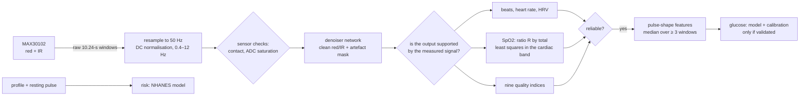

# SuGuard ML

Machine learning for the SuGuard bracelet (ESP32-C3 + MAX30102: red 660 nm, infrared 880 nm,
18-bit ADC).

| Part | State |
|---|---|
| **Motion-artefact removal** — a neural network that cleans red/IR PPG windows. Two versions: a server model (`models/denoiser.onnx`) and a small integer model that runs on the bracelet itself (`models/denoiser_edge_int.npz`, compiled into the [firmware](../firmware/README.md)) | trained; evaluated on simulated sensor data and on real PPG recordings with simulated motion. Not yet tried on a real wrist |
| **Heart rate, SpO2, HRV, signal quality** with reliability gates: a window that fails a check yields no number | implemented in Python and, decision for decision identical, in C++ for the firmware |
| **Diabetes-risk screening** | trained and cross-validated on real data (NHANES 2017–2018, laboratory HbA1c) |
| **Glucose** | training/validation pipeline and personal calibration from fingersticks are ready. **There is no model**: no paired PPG/glucose data from this bracelet exists |

> Research prototype, not a medical device. Glucose from PPG is **not confirmed**: neither the API
> nor the firmware outputs a glucose value.

## Results

All numbers are measured on data the models did not see during training; each table names the
file it comes from.

### Motion artefacts, heart rate, SpO2

Three ways of processing a 10.24-s window are compared:

* **classical** — filters, beat detection and quality checks, no network (firmware: `use_nn 0`);
* **bracelet** — the integer network that runs on the ESP32-C3 (94,667 weights, 45 kB of working memory);
* **server** — the larger network (457,267 parameters, ONNX).

**Whole pipeline with every reliability check**, 600 simulated MAX30102 windows (motion of every
strength, perfusion 0.08–5 %; `models/metrics/denoiser_eval.json` and `denoiser_edge_eval.json`
→ `pipeline_with_gates`):

| | Classical | Bracelet | Server |
|---|---|---|---|
| Windows that get a heart rate | 36 % | 55 % | 57 % |
| … of the windows without motion | 92 % | 97 % | 96 % |
| Heart rate: mean / 95th-percentile error | 1.76 / 2.3 bpm | **0.53 / 1.3 bpm** | **0.52 / 1.4 bpm** |
| Heart-rate errors above 10 bpm | 6 | **0** | **0** |
| Windows that get an SpO2 value | 32 % | 52 % | 56 % |
| SpO2: mean / 95th-percentile error | 0.70 / 2.2 points | **0.20 / 0.6** | **0.16 / 0.5** |
| SpO2 errors above 4 points | 7 | **0** | **0** |

Share of windows that get a heart rate, by how much of the window is really in motion:

| Motion in the window | Classical | Bracelet | Server |
|---|---|---|---|
| 0–5 % | 92 % | 97 % | 96 % |
| 5–30 % | 46 % | 96 % | 98 % |
| 30–70 % | 19 % | 80 % | 89 % |
| more than 70 % | 10 % | 2 % | 1 % |

The last row is intended: when most of a window is motion, the pulse cannot be recovered and no
value is given. The classical path still answers there in 10 % of the windows, and that is where
its large errors come from.

**Inputs that must not produce a value** (`must_not_report`) — number of windows in which a heart
rate / an SpO2 value was reported anyway:

| Input (windows) | Classical | Bracelet | Server |
|---|---|---|---|
| Noise, no pulse (300) | 0 / 0 | 0 / 0 | 0 / 0 |
| No pulse in the infrared channel (300) | 0 / 0 | 0 / 0 | 0 / 0 |
| No pulse, motion only (1500) | 21 / 13 | 1 / 1 | 0 / 0 |
| Pulse in infrared only, none in red (300) ¹ | 296 / 0 | 5 / 0 | 3 / 0 |
| Red pulse at a fifth of its size, in noise (300) ¹ | 189 / 0 | 33 / 0 | 81 / 2 |
| The two LED channels swapped (300) ² | 10 / 10 | 21 / 21 | 18 / 18 |

¹ A heart rate is legitimate here (the infrared pulse is real); an SpO2 value is not.
² A wiring/configuration fault, caught at bring-up (`led red` on the console); the firmware also
prints a hint when the red pulse is persistently larger than the infrared one.

**Real PPG recordings** (heartpy, 835 s: real pulse shapes and rhythm) with a simulated second
wavelength and simulated motion (`real_ppg_simulated_motion`). Errors over *all* windows, no gates,
to show what the network itself does; the last column is the share of windows the gates then let
through:

| Scenario (windows) | Heart-rate error without a network | Bracelet | Server | Pass the gates (bracelet / server) |
|---|---|---|---|---|
| At rest (57) | 1.28 bpm | 0.39 | 0.37 | 72 % / 82 % |
| Walking, motion close to the pulse rate (342) | 21.9 bpm | 4.2 | 3.4 | 11 % / 11 % |
| Gestures, pressure changes (342) | 5.7 bpm | 1.7 | 1.5 | 11 % / 19 % |
| Mixed (342) | 13.7 bpm | 3.2 | 2.9 | 20 % / 26 % |

In the windows that pass the gates the heart-rate error is 0.3–1.4 bpm. So during continuous
motion the bracelet gives a value for one window in five to ten, and that value is good; it does
not give one for the others.

**What these numbers do not show**

* All motion is simulated. The decisive test is the bracelet on a wrist next to a reference
  (chest strap or finger oximeter); the Colab notebook adds real motion from PPG-DaLiA (one green
  channel, so it only tests part of the method).
* The classical path cannot tell rhythmic motion from a pulse (the rows above); it is there for
  diagnostics.
* SpO2 uses Maxim's generic curve and is **not calibrated** for this enclosure. In simulation it
  reads 0.3–0.5 points high below 90 %.
* With the two LED channels swapped, windows still pass when the true saturation is below about
  88 % (3–7 % of that test set), and the SpO2 shown is then several points too low. Check the LED
  order once at bring-up.

### Diabetes risk — `models/risk_model.json`

NHANES 2017–2018, 4,318 adults without a diabetes diagnosis, out-of-fold (5 × 5-fold
cross-validation; `models/metrics/risk_cv.json`):

| Target | AUC [95 % CI] | Calibration slope |
|---|---|---|
| HbA1c ≥ 5.7 % (prediabetes or diabetes), 34 % of the sample | **0.770** [0.756–0.783] | 1.00 |
| HbA1c ≥ 6.5 % (undiagnosed diabetes), 3.6 % | **0.789** [0.749–0.815] | 0.97 |

Inputs: age, sex, BMI, resting pulse (from the bracelet), physical activity, ancestry (Asian /
European / other). Without ancestry the model under-estimated Asian participants (0.28 predicted
vs 0.38 observed) and over-estimated White ones (0.37 vs 0.28); with it both are calibrated
(0.382 vs 0.383 and 0.277 vs 0.277; `risk_cv.json` → `subgroup_calibration` and
`subgroup_calibration_without_ancestry`). Systematic errors of 4–6 points remain for Black
(0.40 vs 0.46), Mexican-American (0.34 vs 0.29), other Hispanic (0.37 vs 0.32) and multiracial
participants (0.34 vs 0.30). The result is in the range reported for screening questionnaires
(ADA risk test, FINDRISC) and is **not a diagnosis**. NHANES is a US sample: for Kazakhstan the
calibration has to be confirmed on local data with HbA1c.

## Glucose: what is real and what is not

* **"Pulse + saturation → accurate blood sugar" does not work.** Heart rate and SpO2 carry almost
  no information about glucose. If anything can work, it is the shape of the pulse wave together
  with context (time of day, meals) and personal calibration, and that has to be proven on data.
* Under subject-independent testing, published PPG glucose models fall to R² ≈ 0; the high figures
  come from leakage (the same person in training and test) —
  [Reassessing the Feasibility of PPG-Based Non-Invasive Blood Glucose Level Estimation, arXiv 2608.01820](https://arxiv.org/abs/2608.01820).
* Even a constant looks good. Real CGM data (`scripts/benchmark_calibration.py`,
  `models/metrics/calibration_baselines_cgm.json`):

  | Cohort (real CGM) | "Population mean" for everyone | Last fingerstick carried forward | Kalman calibration on fingersticks only |
  |---|---|---|---|
  | 19 people without a diabetes diagnosis, normal to diabetic on testing (Hall 2018) | MARD **16.8–16.9 %** | 17.8–20.4 % | **15.3–16.4 %** |
  | 5 people, type 2 diabetes (Broll 2021) | MARD 35 % | 21.5–27.7 % | **21.7–22.7 %** |

  An "accuracy of 83 %" (100 − MARD) in people without marked diabetes is what a constant gives.
* `scripts/train_glucose.py` therefore reports three protocols (a random split, only to show how
  much it inflates the result; new people; calibration with scheduled fingersticks on the first
  days, scored on later days), baselines without PPG (level from fingersticks, last fingerstick,
  personal time-of-day profile), two controls ("context only" and "PPG shuffled within a person"),
  bootstrap confidence intervals over people and a locked hold-out group. A model is marked
  `validated` **only** if: the table is labelled as data from the SuGuard bracelet; ≥ 20 people;
  at least 80 % of them could be scored; ≥ 10 % better than the best baseline with the lower
  confidence bound above zero; PPG beats both controls; MARD ≤ 15 % and Clarke A+B ≥ 99 % after
  calibration; and, on the locked hold-out people, the same MARD and Clarke bar, at least 80 % of
  them scored and a gain over the best baseline (the controls and the confidence bound are not
  repeated there: the group is small). A check that cannot be run counts as failed.
* **No glucose number without a validated model.** With no model installed (today) the API answers
  `unavailable`, or, after three fingersticks, `calibration_only` with the note "this is the
  average of your recent fingerstick readings, not a reading from the bracelet". A model that is
  installed but not validated answers `not_validated`, without a number; only with
  `SUGUARD_EXPERIMENTAL_GLUCOSE=1` set on the server (research with informed participants) does it
  return its estimate, as status `experimental`.
* A positive and a negative control (`tests/test_models.py`) prove that this logic finds a real
  signal and does not mistake time of day or noise for one.

What it takes to make glucose real: [docs/DATA_COLLECTION.md](docs/DATA_COLLECTION.md).

## Architecture



* Red and IR are scaled by **one** factor, so the network keeps their ratio (the basis of SpO2)
  and can learn that motion changes the two channels in a different proportion than arterial
  pulsation does.
* **The network is not trusted blindly.** A network trained to output a clean pulse can draw one
  out of noise. On the samples it calls clean, its output must match the measured signal
  (correlation ≥ 0.7, amplitude ratio 0.7–1.4); the strength of the pulse is judged on the
  measured signal, not on the output; a red/IR ratio that arterial blood cannot produce rejects
  the window.
* Separate gates: heart rate needs a trustworthy rhythm; SpO2 and the glucose features also need
  both wavelengths to agree.
* `suguard_ml.pipeline.vitals_from_signals` is the single definition of "reliable". The firmware's
  C++ core is its twin and is tested against it window by window
  ([firmware/README.md](../firmware/README.md#verification)).

## Quick start

```bash
cd ml
python -m venv .venv && . .venv/bin/activate
pip install -r requirements.txt
python -m pytest -q                      # 51 tests
uvicorn api.app:app --port 8000
```

```python
from suguard_ml.pipeline import SuGuardPipeline
pipe = SuGuardPipeline.load()                       # models/denoiser.onnx
res = pipe.analyze(red_counts, ir_counts, fs=50)    # raw MAX30102 counts of one window (the bracelet sends 10.24 s at 50 Hz)
res["reliable"], res["heart_rate"]["bpm"], res["spo2"]["percent"], res["quality"]["sqi"]
res.get("reason")                                   # why a window was rejected
```

### API

| Method | Purpose |
|---|---|
| `GET /health` | which models are loaded |
| `POST /v1/analyze` | `{fs, red[], ir[], timestamp, temperature_c}` → reliability, heart rate, SpO2, HRV, features |
| `POST /v1/glucose/estimate` | features of ≥ 3 different reliable windows + calibration state → glucose **with a status** (see above) |
| `POST /v1/glucose/calibrate` | a fingerstick → new calibration state (kept by the client) |
| `POST /v1/risk` | age, height/weight, sex, ancestry, resting pulse, activity → probabilities, category, contributing factors |

```bash
curl -s localhost:8000/v1/risk -H 'content-type: application/json' \
  -d '{"age": 52, "height_cm": 172, "weight_kg": 90, "ancestry": "asian", "resting_hr_bpm": 78, "physically_active": false}'
```

Docker image without PyTorch: `docker build -f api/Dockerfile -t suguard-ml . && docker run -p 8000:8000 suguard-ml`.
Limits: body ≤ 2 MB, ≤ 60,000 samples per channel, sample rates from 25 to 1000 Hz (resampled to
50 Hz), times in unix seconds.
Set `SUGUARD_STATE_KEY` (a long random string) in production: the server then signs the calibration
states it hands out and refuses any other; without it a client can send a state it made up
(values are still range-checked). Leave `SUGUARD_EXPERIMENTAL_GLUCOSE` unset unless you run a
study (see above); `/health` shows both settings. The API has no user authentication of its
own — put it behind your backend.

## Recommendations for the app and the website

The models are only as honest as the way they are shown:

1. **Remove the heuristic "diabetes risk %"** in `f_app/lib/services/health_service.dart` (85 of its
   100 points come from the unconfirmed "glucose" stream) and use `/v1/risk` instead: "probability
   of elevated HbA1c, a screening estimate", category, contributing factors, and the advice to take
   an HbA1c or fasting-glucose test.
2. **Remove the automatic e-mail to the emergency contact at risk ≥ 70.** A chronic risk is not an
   emergency, and a message to a third person should be an explicit action of the user. Emergency
   alerts belong to verified acute events, which the device cannot detect yet.
3. **Show no mg/dL from the bracelet** while no model is `validated`. In a research mode: a range
   with an interval, a permanent "experimental" label, no hypo/hyperglycaemia alerts.
4. **Label SpO2 "not calibrated"** until it has been calibrated against a medical pulse oximeter.
5. **The "94 % accuracy" on the website** needs a study behind it (how many people, which split,
   which reference) or should go; add "not a medical device".
6. **Read the bracelet's records.** The firmware writes `users/<uid>/vitals` (pulse, SpO2, signal
   quality — no glucose); the app reads `users/<uid>/healthData` and requires a `glucose` number
   in every entry.
7. Ask for sex and ancestry in the profile (they improve the risk estimate) and store the consent
   to process health data.

## Training

```bash
python scripts/train_risk.py --out models                          # NHANES, ~2 min
python scripts/benchmark_calibration.py --out models/metrics       # real CGM baselines
python scripts/make_denoiser_dataset.py --out data/denoiser        # 150,000 windows, ~15 min on 4 CPUs

# server model (~45 min on a CPU, minutes on a GPU)
python scripts/train_denoiser.py --data data/denoiser --steps 12000 --out models
python scripts/eval_denoiser.py --data data/denoiser --out models/metrics

# bracelet model: train, convert to integers, write the firmware header, evaluate the integer model
python scripts/train_denoiser.py --data data/denoiser --arch edge --steps 12000 --out data/edge_s
python scripts/export_edge_model.py --ckpt data/edge_s/denoiser_edge.pt --data data/denoiser
python scripts/eval_denoiser.py --data data/denoiser --edge-int models/denoiser_edge_int.npz --name denoiser_edge_eval

# glucose, once paired data exists (docs/DATA_COLLECTION.md)
python scripts/train_glucose.py --table data/suguard_paired.parquet --out models --name suguard
```

After `export_edge_model.py` run `python -m pytest ../firmware/tests`: the firmware must reproduce
the new model bit for bit.

Colab notebook with a GPU and the public datasets (BIG IDEAs, PPG-DaLiA, NHANES survey weights):
[notebooks/SuGuard_ML_Colab.ipynb](notebooks/SuGuard_ML_Colab.ipynb).

## Layout

```
suguard_ml/
  signal/    filters, beats (Elgendi), spo2 (total least squares), quality, features (morphology, SDPPG, harmonics)
  synth/     MAX30102 simulator with motion artefacts (used for the denoiser only)
  models/    denoiser_net (PyTorch), denoiser (ONNX runtime), edge_int (integer reference of the bracelet model),
             glucose (model wrapper + personal calibration), risk
  data/      nhanes, cgm (iglu), realppg (heartpy), bigideas, paired (your own recordings)
  eval/      glucose metrics (Clarke grid, ISO 15197, MARD), heart-rate/SpO2 scoring
  aggregation.py   window features → model input (shared by training and the API)
  pipeline.py      vitals_from_signals: the reliability decision; SuGuardPipeline.analyze
api/  scripts/  models/ (+ metrics/)  notebooks/  docs/ (DATA_COLLECTION.md, MODEL_CARD.md)  tests/
```

The bracelet firmware (raw-data acquisition, the on-device pipeline, upload, PC recording tool)
is in [`../firmware`](../firmware/README.md).

## Data sources

* NHANES 2017–2018 (CDC, public domain) through the [`nhanes`](https://pypi.org/project/nhanes/) package.
* Real CGM: `iglu-py` example data (Broll et al. 2021; Hall et al., PLoS Biol 2018) — evaluation only.
* Real PPG: `heartpy` example recordings (van Gent et al. 2019) — evaluation only.
* In Colab: [BIG IDEAs Lab Glycemic Variability and Wearable Device Data](https://physionet.org/content/big-ideas-glycemic-wearable/) (PhysioNet),
  [PPG-DaLiA](https://archive.ics.uci.edu/dataset/495/ppg+dalia) (UCI).
