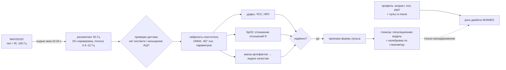

# SuGuard ML

Машинное обучение для браслета SuGuard (ESP32 + MAX30102: красный 660 нм, ИК 880 нм, 18-битный АЦП):

1. **очистка сигнала от движения** — нейросеть (1D U-Net) на двух каналах красный/ИК;
2. **ЧСС, SpO2, HRV и индекс качества** — из очищенного сигнала, со «стоп-краном»: если окно ненадёжно, число не выдаётся;
3. **оценка глюкозы** — популяционная модель + персональная калибровка по глюкометру, с честным статусом;
4. **риск диабета** — откалиброванная модель, обученная на реальных данных NHANES (лабораторный HbA1c).

> ⚠️ Исследовательский прототип, не медицинское изделие. Глюкоза по PPG **не подтверждена** на данных
> SuGuard — см. раздел «Глюкоза: что реально, а что нет».

## Статус и результаты

| Компонент | Статус | Обучение / проверка | Результат (на данных, не участвовавших в обучении) |
|---|---|---|---|
| Очистка от движения | ✅ обучена, `models/denoiser.onnx` | симуляция MAX30102 (150 тыс. окон); проверка на реальных PPG-записях | DENOISER_RESULTS |
| ЧСС / SpO2 / качество | ✅ | — | DENOISER_GATE |
| Риск диабета | ✅ обучена, `models/risk_model.json` | NHANES 2017–2018, 4318 взрослых без диагноза | AUC **0.749** [0.735–0.764] для HbA1c ≥ 5.7 %, **0.756** [0.718–0.785] для HbA1c ≥ 6.5 %; калибровка: наклон 0.99–1.00 |
| Глюкоза | ⚠️ конвейер готов, **модель не обучена** | нужны парные данные «PPG ↔ глюкоза» (BIG IDEAs в Colab или свои) | планка, которую нужно побить: см. ниже |

Все числа — в `models/metrics/*.json`, их можно воспроизвести командами из раздела «Обучение».

## Архитектура



* Сигналы red и IR нормируются **одним** коэффициентом, поэтому сеть сохраняет их отношение (основа SpO2)
  и учится отличать движение (меняет оба канала в другой пропорции, чем пульс артерий).
* Маска артефактов — второй выход сети; окно с > 50 % «движения» не выдаёт ЧСС/SpO2/глюкозу.
* Риск учитывает глюкозу браслета только через байесовское обновление (GMI → HbA1c) и **только**
  если для глюкозы известна проверенная ошибка — плохая модель глюкозы не может «накрутить» риск.

## Глюкоза: что реально, а что нет

* **«Пульс + сатурация → точный сахар» не работает.** ЧСС и SpO2 почти не содержат информации о глюкозе;
  максимум, на что можно рассчитывать, — форма пульсовой волны (жёсткость сосудов, микроциркуляция),
  контекст (время, еда) и персональная калибровка.
* Независимые проверки показывают, что опубликованные PPG-модели глюкозы при разбиении **по людям**
  падают до R² ≈ 0, а высокие цифры получаются из-за утечки (один человек в train и test)
  ([arXiv 2608.01820](https://arxiv.org/abs/2608.01820)).
* Даже константа даёт «хорошие» цифры. Реальные CGM-данные (`scripts/benchmark_calibration.py`):

  | Когорта (реальные CGM) | «Среднее по популяции» | Последний укол глюкометра | Калибровка Калмана |
  |---|---|---|---|
  | 19 чел., преддиабет/СД (Hall 2018) | MARD **16.9 %**, Кларк A 68 % | 17.8–20.4 % | **15.1–16.1 %** |
  | 5 чел., СД2 (Broll 2021) | MARD 35 % | 21.5–27.7 % | **21.6 %** |

  То есть «точность 83 %» (100 − MARD) у людей без выраженного диабета даёт константа.
  Модель браслета полезна, только если **обгоняет эти числа** на новых людях и будущих днях.
* `scripts/train_glucose.py` всегда считает три протокола (случайное разбиение — только чтобы показать
  завышение; по людям; персональная калибровка на будущих днях), сравнивает с базовыми моделями и с
  моделью «только контекст» и выставляет `validated`. Без `validated` API отдаёт статус
  `experimental`, а без обученной модели — `unavailable` (числа нет) или `calibration_only`.
* Положительный/отрицательный контроли (`tests/test_models.py`) проверяют, что эта логика ловит и
  настоящий сигнал, и его отсутствие (в т.ч. когда «работает» только время суток).

Что нужно, чтобы глюкоза стала реальной: [docs/DATA_COLLECTION.md](docs/DATA_COLLECTION.md).

## Быстрый старт

```bash
cd ml
python -m venv .venv && . .venv/bin/activate
pip install -r requirements.txt
python -m pytest -q                      # 28 тестов
uvicorn api.app:app --port 8000          # API
```

```python
from suguard_ml.pipeline import SuGuardPipeline
pipe = SuGuardPipeline.load()                       # models/denoiser.onnx
res = pipe.analyze(red_counts, ir_counts, fs=100)   # сырые отсчёты MAX30102
res["heart_rate"]["bpm"], res["spo2"]["percent"], res["quality"]["sqi"], res["reliable"]
```

### API

| Метод | Назначение |
|---|---|
| `GET /health` | какие модели загружены |
| `POST /v1/analyze` | `{fs, red[], ir[], timestamp, temperature_c, context, calibration}` → качество, ЧСС, SpO2, HRV, признаки, глюкоза со статусом |
| `POST /v1/glucose/calibrate` | укол глюкометра → новое состояние калибровки (хранит клиент, напр. Firebase `users/<uid>/mlCalibration`) |
| `POST /v1/risk` | возраст, рост/вес или ИМТ, пол, пульс в покое, активность (+ проверенная глюкоза) → вероятности и категория |

```bash
curl -s localhost:8000/v1/risk -H 'content-type: application/json' \
  -d '{"age": 52, "height_cm": 172, "weight_kg": 90, "resting_hr_bpm": 78, "physically_active": false}'
```

Docker (без PyTorch): `docker build -f api/Dockerfile -t suguard-ml . && docker run -p 8000:8000 suguard-ml`.

## Обучение

```bash
python scripts/train_risk.py --out models                         # NHANES, ~1 мин
python scripts/benchmark_calibration.py --out models/metrics      # реальные CGM
python scripts/make_denoiser_dataset.py --out data/denoiser       # 150 тыс. окон, ~15 мин на 4 CPU
python scripts/train_denoiser.py --data data/denoiser --steps 12000 --out models   # ~40 мин CPU / минуты на GPU
python scripts/eval_denoiser.py --data data/denoiser --out models/metrics
# глюкоза — на парных данных (свои или BIG IDEAs):
python scripts/train_glucose.py --table data/paired.parquet --out models
```

Colab с GPU и загрузкой открытых датасетов (BIG IDEAs, PPG-DaLiA):
[notebooks/SuGuard_ML_Colab.ipynb](notebooks/SuGuard_ML_Colab.ipynb).

## Прошивка

`firmware/suguard_raw_stream` — эталонный скетч ESP32 + MAX30102: 100 Гц, оба светодиода, окна
10.24 с, отправка в API (`MODE_API`) или в Firebase для сбора обучающих данных (`MODE_COLLECT`).
Сырые отсчёты обязательны: из готовых чисел pulse/spo2, которые сейчас пишет устройство, движение
убрать уже нельзя.

## Структура

```
suguard_ml/
  signal/    filters, beats (Elgendi), spo2, quality, features (морфология, SDPPG, гармоники)
  synth/     симулятор MAX30102 + артефакты движения (только для нейросети-очистителя)
  models/    denoiser_net (PyTorch), denoiser (ONNX runtime), glucose, risk
  data/      nhanes, cgm (iglu), realppg (heartpy), bigideas, paired (свои данные)
  eval/      метрики глюкозы (Кларк, ISO 15197, MARD), оценка ЧСС/SpO2
  pipeline.py
api/         FastAPI + Dockerfile
scripts/     обучение и оценка
models/      обученные модели и метрики
firmware/    ESP32 скетч
docs/        DATA_COLLECTION.md, MODEL_CARD.md
```

## Источники данных

* NHANES 2017–2018 (CDC, общественное достояние) через пакет [`nhanes`](https://pypi.org/project/nhanes/).
* Реальные CGM: пакет `iglu-py` (данные Broll et al. 2021; Hall et al., PLoS Biol 2018) — только для оценки.
* Реальные PPG: пакет `heartpy` (van Gent et al. 2019) — только для оценки.
* В Colab: [BIG IDEAs Lab Glycemic Variability](https://physionet.org/content/big-ideas-glycemic-wearable/) (PhysioNet, ODC-By),
  [PPG-DaLiA](https://archive.ics.uci.edu/dataset/495/ppg+dalia) (UCI).
